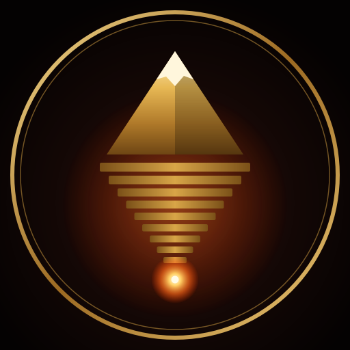
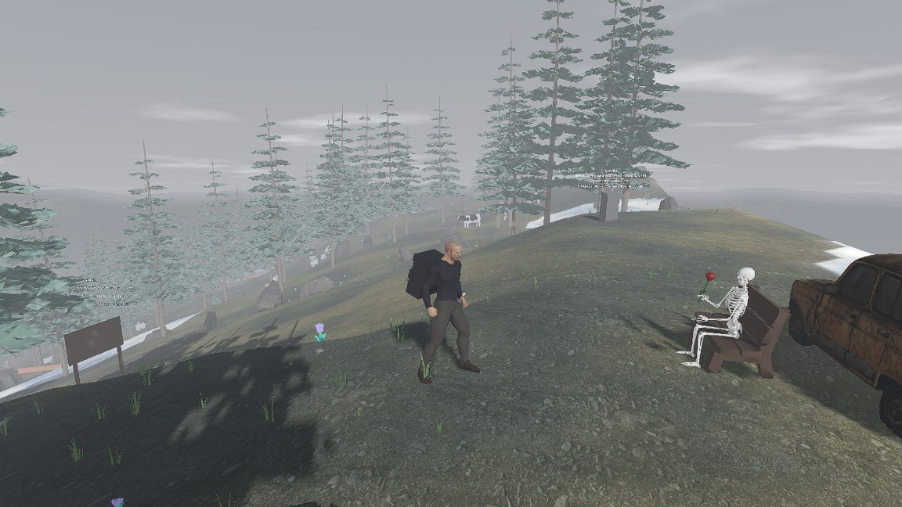
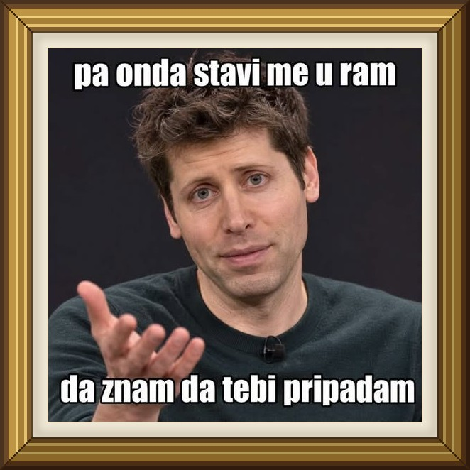
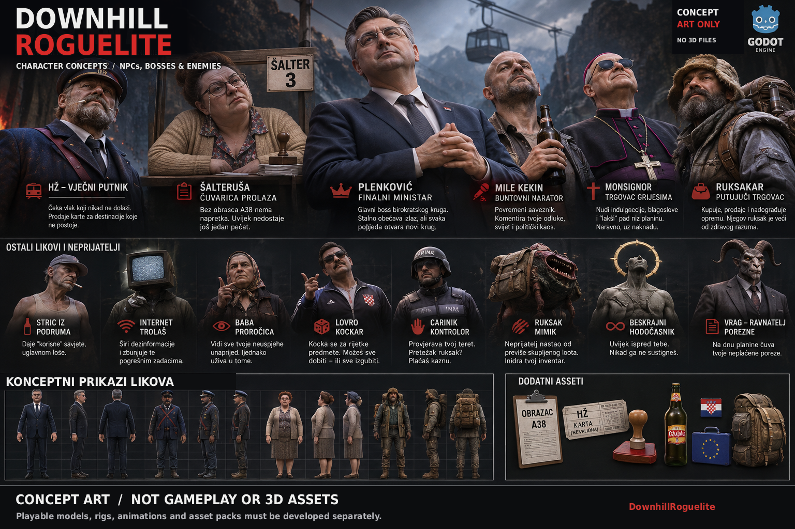
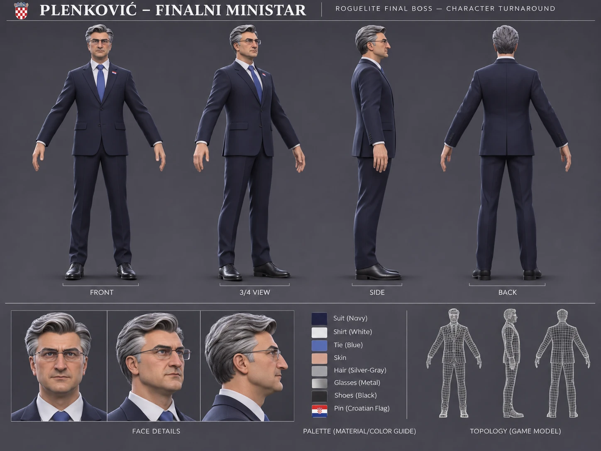
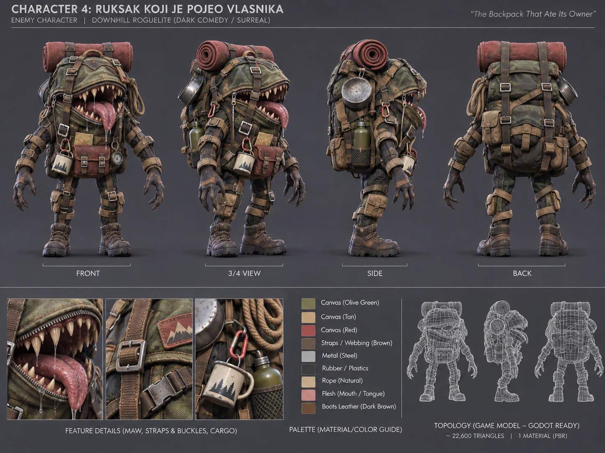
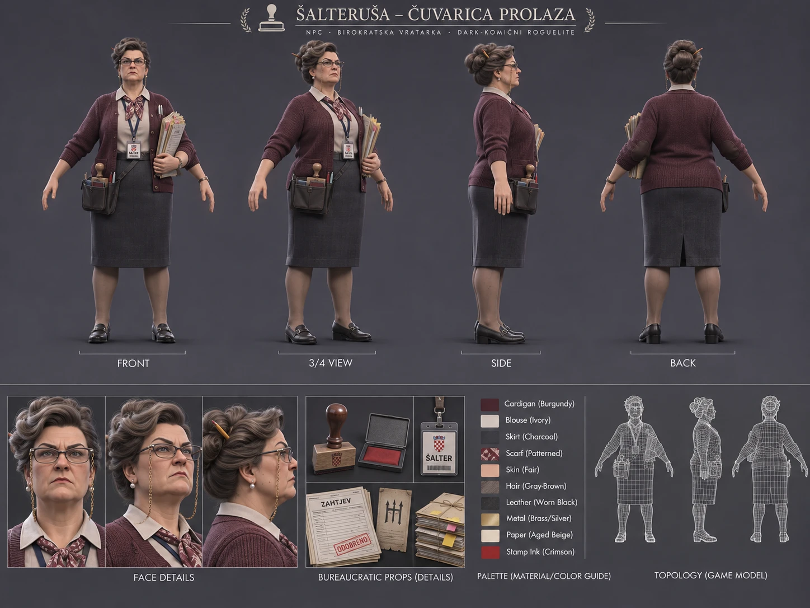
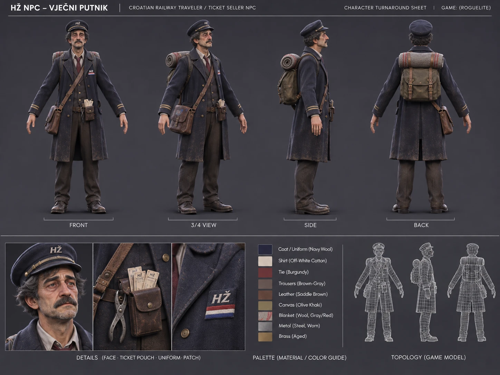

<div align="center">



# Downhill Roguelite

**An endless third-person descent roguelite.**

*Carry your world on your back. Keep your balance. Go deeper.*

A dark survival adventure about descending a mountain that never ends — toward godhood you can never quite reach.

**Godot 4.7 .NET · C# · Windows and Linux playtests · In active development**

## ⬇ Download the game (free)

[](https://github.com/vstimac/DownhillRoguelite/releases/download/v0.2.5-beta/DownhillRoguelite-beta-2.5-windows.zip)

[](https://github.com/vstimac/DownhillRoguelite/releases/download/v0.2.5-beta/DownhillRoguelite-linux-beta.tar.gz) [](https://discord.gg/vhPkSvPk2)

**Click the green button → right-click the ZIP → Extract All → run `DownhillRoguelite.exe`.** [How to install](#download-and-play) · [All releases](https://github.com/vstimac/DownhillRoguelite/releases) · [Report feedback](https://github.com/vstimac/DownhillRoguelite/issues/new/choose)

</div>

---

## Gameplay

*Real, unedited in-game capture from the current development build.*



**Carry everything you own down a mountain that never ends.** Pack a backpack cell by cell, feel its weight pull at your balance, read the weather and reach the next station's fire before dark. Every run is a new procedural mountain; every death is final. Each run starts beside an old Reno 4 on the summit: press **E** on the car and the skeleton with the rose plays you a song, **K** opens the music player.

### System requirements

| | Minimum | Recommended |
| --- | --- | --- |
| **OS** | 64-bit Windows 10 / 11 (Linux experimental) | 64-bit Windows 11 |
| **Graphics** | Vulkan-capable GPU with up-to-date drivers (integrated graphics start on Low quality) | Dedicated NVIDIA / AMD GPU |
| **Storage** | ~1 GB free | ~3.5 GB with the optional AI companion model |
| **Sound** | | Headphones (directional voices) |
| **Heart** |  | |

## Download and play

**Latest published Windows build: [v0.2.5-beta](https://github.com/vstimac/DownhillRoguelite/releases/tag/v0.2.5-beta)** (10 November 2026).

1. Download [`DownhillRoguelite-beta-2.5-windows.zip`](https://github.com/vstimac/DownhillRoguelite/releases/download/v0.2.5-beta/DownhillRoguelite-beta-2.5-windows.zip) (~390 MB).
2. Right-click the ZIP and choose **Extract All**. **Don't run the game from inside the ZIP**: Windows then copies only the `.exe` out and the game closes straight away.
3. Open the extracted folder and run **`DownhillRoguelite.exe`**. Keep the files in that folder together.
4. **Updates:** when a new version is out, close the game and double-click **`Update game.bat`** in the same folder. It downloads only what changed (usually a few MB).

**Nothing else to install:** .NET is included in the download. **Requirements:** 64-bit Windows 10/11 and up-to-date graphics drivers (Vulkan) from NVIDIA, AMD or Intel. Headphones recommended.

**If the game closes straight away or shows a .NET error:**
- Make sure you extracted the whole ZIP (step 2) and are starting the `.exe` inside the extracted `DownhillRoguelite-playtest1` folder, not a copy of the `.exe` on its own.
- Update your graphics drivers.
- The talking companion (optional) also needs the [Microsoft Visual C++ Redistributable (x64)](https://aka.ms/vs/17/release/vc_redist.x64.exe) on older builds; the game runs without it.
- Still stuck? [Open an issue](https://github.com/vstimac/DownhillRoguelite/issues/new/choose) and attach `%APPDATA%\Godot\app_userdata\Downhill Roguelite\logs\godot.log`.

**Linux (experimental):** Download [`DownhillRoguelite-linux-beta.tar.gz`](https://github.com/vstimac/DownhillRoguelite/releases/download/v0.2.5-beta/DownhillRoguelite-linux-beta.tar.gz) from the same Beta 2.5 release (64-bit, Vulkan). Follow [Linux instructions](docs/LINUX.md).

Beta 2.5 lets you save and quit a run and continue it later, adds a Ground fog switch, makes crates, logs and carts give way when you bump into them, and from now on updates download only what changed. Beta 2.4 brought sword and shield combat with lock-on, two new enemies, a dive and roll, modelled clothes, hand carts, ground fog that flows downhill, and starts on Low quality on laptops without a graphics card. Beta 2.3 added a forest at human scale, a new modular carrier, night beasts that stalk you after dark, the president at the rest site, a loading screen so the mountain is ready before you start, a smoother frame rate and a Wallpaper folder to thank our beta testers. It builds on Beta 2.2's title screen, Options, cargo jobs, relics and walking with weight. This is a playtest, not a finished release.

## Join the project — we need your help!

**DownhillRoguelite is looking for friends and volunteers** who enjoy Godot/C#, original 3D modelling, animation, sound design, UI and hands-on beta testing.

You don't need to be a professional: help with a single model, animation, bug report or playtest.

**Come and talk to us on [Discord](https://discord.gg/vhPkSvPk2)**: playtest news, builds, feedback and a place to say hello before you help.

**[I want to help →](https://github.com/vstimac/DownhillRoguelite/issues/new?template=help-wanted.md)** · [Join the Discord](https://discord.gg/vhPkSvPk2) · [Contribution guidelines](.github/CONTRIBUTING.md) · [Open issues](https://github.com/vstimac/DownhillRoguelite/issues)

*Open collaboration; no paid position is being advertised. Project code uses MIT, while art, music, voices and other assets have separate rights; read [RIGHTS.md](RIGHTS.md) before uploading files.*

## About

Each run begins at the summit of a procedurally generated mountain. You choose routes, hunt for supplies, reach the next station before nightfall and try to descend deeper than before. Death ends the run; a new mountain awaits.

The setting takes inspiration from Dante's nine circles, with the philosophical pursuit of unreachable godhood at its center. The full nine-circle vision is a long-term direction, **not a claim that all nine are playable now**.

### Gameplay systems

| System | What it means in play |
| --- | --- |
| Backpack and balance | Heavy or poorly placed cargo shifts your balance; lean or brace to stay on your feet |
| Survival | Manage health, hunger, thirst, stamina and exposure to weather |
| Routes and stations | Explore branching paths, reach fires, rest, repack and choose boons |
| Roguelite runs | New procedural mountains, depth records and permanent death |
| Gear and inventory | Pack items in a 3D grid; equip clothing and maintain its durability |
| Map and journal | Set waypoints, explore fog of war and record the journey |
| Narration and encounters | A companion narrates the descent; encounter travellers along the route |
| Night and fire | Night beasts stalk you after dark (deeper down a giant spider too); a torch holds them back and lights the way |
| Combat and loot | Sword and shield fights with enemies on the route; every kill drops supplies, sometimes something better |
| Living world | Grass and trees sway in the wind, leaves fall in the autumn woods, fireflies glow on dry nights |
| Achievements | 18 achievements across your runs, kept even when you die |

Features may vary by released build and development branch.

## Controls (keyboard and mouse)

| Key | Action |
| --- | --- |
| **W A S D** / mouse | Move / look |
| **Shift** / **Space** | Sprint / jump |
| **C** | Careful movement on difficult ground |
| **Left / right mouse buttons** | Lean left / right; hold both to brace |
| **E** | Pick up items, interact, rest or talk to travellers |
| **F** / **Q** | Eat / drink |
| **1–9**, mouse wheel, **V**, **G** | Select hotbar slot, use selected item, drop item |
| **I** / **M** / **J** | Inventory / map / journal |
| **Tab** | Repack backpack at a station |
| **X** | Put your torch away / light it again |
| **Enter** | Talk to the companion (optional local model) |
| **Esc** | Pause, settings and control reference |
| **R** | Give up the run and start a new mountain |

**Map:** click to set a waypoint, right-click to remove it, drag to pan, scroll to zoom. **UI:** hold Alt to reposition interface elements; Alt+Backspace restores the layout. For advanced packing controls, see the [full playtest guide](docs/playtest-1-release.md).

## Character concept gallery



*Visual concept board, not a gameplay screenshot or proof of game-ready 3D models. Depicted characters and props are concepts until implemented and validated in-game.*

<details>
<summary><strong>⚠️ Spoilers: who waits further down the mountain</strong> (click to open)</summary>

<br>

*Concept turnaround sheets for upcoming characters: concept art, not gameplay, and not in the game yet. Satire: the characters are fictional caricatures.*

**Plenković — Finalni ministar** · the final boss



**Ruksak koji je pojeo vlasnika** · The Backpack That Ate Its Owner, an enemy



**Šalteruša — Čuvarica prolaza** · the bureaucratic gatekeeper, an NPC



**HŽ — Vječni putnik** · the eternal railway traveller who sells tickets, an NPC



</details>

**Gameplay screenshots:** see [Gameplay](#gameplay) above — real in-game captures only; concept renders and AI artwork are labelled separately. See the [capture and publishing guide](docs/MEDIA_CAPTURE.md).

## Optional: local AI companion

The companion can respond to typed messages if you supply the optional local model [Qwen2.5-3B-Instruct GGUF (Q4_K_M)](https://huggingface.co/Qwen/Qwen2.5-3B-Instruct-GGUF/resolve/main/qwen2.5-3b-instruct-q4_k_m.gguf) (about 2.1 GB). Create a `Models` folder **beside `DownhillRoguelite.exe`**, then place `qwen2.5-3b-instruct-q4_k_m.gguf` inside it. The game otherwise works without the model; conversational replies are unavailable.

## Build from source (developers)

Use **Godot 4.7.2 .NET/Mono**, **.NET SDK 8+**, and the optional/additional dependencies described in [Building](docs/BUILDING.md).

```bash
git clone https://github.com/vstimac/DownhillRoguelite.git
cd DownhillRoguelite/game
dotnet build
```

The game lives in the `game/` folder. Open `game/project.godot` with the **.NET edition** of Godot. Some libraries and licensed character source assets are intentionally not stored in the repository. Follow [docs/BUILDING.md](docs/BUILDING.md) and [addons/README.md](game/addons/README.md) before troubleshooting a fresh clone.

## Feedback and project documentation

Found a bug or had an idea? [Open a GitHub issue](https://github.com/vstimac/DownhillRoguelite/issues/new) and include the build version, steps to reproduce, and a screenshot or log when possible.

- [Playtest guide and full controls](docs/playtest-1-release.md)
- [Build instructions](docs/BUILDING.md) · [Linux guide](docs/LINUX.md)
- [Survival design](docs/survival-loop.md) · [Inventory design](docs/inventory-design.md) · [Narrative](docs/narrative.md)
- [Art credits and third-party asset notices](game/art/CREDITS.md)

## Credits and rights

Art, audio, character models and third-party materials have **different rights and terms**. See [art/CREDITS.md](game/art/CREDITS.md) and each asset pack's license file. The concept gallery is not a downloadable 3D character pack. Mixamo sources and some optional model files are not included in Git.

**Original project source code:** [MIT License](LICENSE) — permits reuse with the required copyright and license notice. **Game assets, character art, logo, music, voice recordings, narrative and third-party libraries are not automatically MIT.** Read [RIGHTS.md](RIGHTS.md), check [art/CREDITS.md](game/art/CREDITS.md) and obtain permissions where necessary. MIT's warranty disclaimer does not protect against unlicensed third-party content or all legal claims.

---

<div align="center"><strong>Downhill Roguelite</strong> · A mountain without an end.</div>
