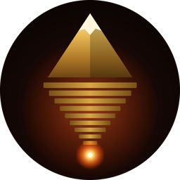
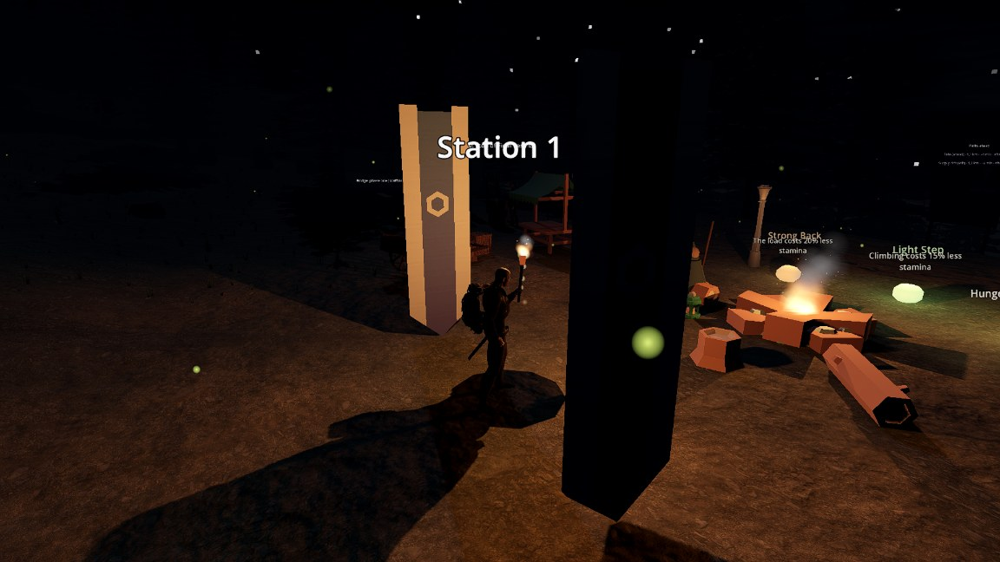

<div align="center">



# Downhill Roguelite

**Carry your world on your back. Keep your balance. Go deeper.**

A free survival adventure about walking down a mountain that never ends.

<br>

## ⬇ Play it now — it's free

[](https://github.com/vstimac/DownhillRoguelite/releases/download/v0.2.9-beta/DownhillRoguelite-windows.zip)
&nbsp;&nbsp;
[](https://github.com/vstimac/DownhillRoguelite/releases/download/v0.2.9-beta/DownhillRoguelite-linux-x86_64.tar.gz)

**Download it once.** The game then updates itself to the newest version. No account, no installer, nothing else to install.

</div>

### How to start (Windows) — 3 steps

| | |
|:-:|---|
| **1** | Click the green **DOWNLOAD FOR WINDOWS** button above and wait for the ZIP to finish. |
| **2** | Find the ZIP in your **Downloads** folder → **right-click** it → **Extract All** → **Extract**. |
| **3** | Open the new folder and double-click **`DownhillRoguelite.exe`** (the golden mountain icon). |

> **Windows says "Windows protected your PC"?** That is normal for a small free game. Click **More info**, then **Run anyway**.
>
> **The game closes at once?** You started it from inside the ZIP. Do step 2 first, then start the `.exe` in the extracted folder.

**Updates come by themselves:** when a new version is out, the game's title screen shows **Update**. Click it and the game updates and starts again. You never need to download it twice.

<details>
<summary><b>Linux</b></summary>

1. Click **DOWNLOAD FOR LINUX** and unpack the archive anywhere you can write to.
2. Run `./DownhillRoguelite.x86_64` (if it won't start: `chmod +x DownhillRoguelite.x86_64`).

You need a GPU with Vulkan drivers. Updates work the same way as on Windows: pick **Update** on the title screen. More in the [Linux guide](docs/LINUX.md).

</details>

<details>
<summary><b>It doesn't work — help</b></summary>

- Make sure you extracted the whole ZIP and are starting the `.exe` inside the extracted folder, not a copy of the `.exe` on its own.
- Update your graphics drivers (NVIDIA, AMD or Intel). The game needs Vulkan.
- You need 64-bit Windows 10 or 11 and about 1 GB of free space.
- Still stuck? [Ask on Discord](https://discord.gg/vhPkSvPk2) or [open an issue](https://github.com/vstimac/DownhillRoguelite/issues/new/choose) and attach `%APPDATA%\Godot\app_userdata\Downhill Roguelite\logs\godot.log`.

</details>

---

## What is it?


**You start on the summit with a backpack. The only way is down.**

- 🎒 **Pack your backpack piece by piece.** Everything you carry has weight, and the weight pulls at your balance.
- 🔥 **Reach the next fire before dark.** Night kills outside a shelter. Stations are safe.
- ⚔️ **Fight or run.** Ogres, a backpack that ate its owner, a giant spider that hunts at night.
- ⛰️ **A new mountain every run.** Death is final; the next descent is a different mountain. Or type your own seed and share it with friends.
- 🗣️ **A companion who talks back**, travellers at the fires, and a counter clerk who is never in a hurry.



**[Join the Discord](https://discord.gg/vhPkSvPk2)** to tell us what broke, what was fun and what you want next. · [All versions](https://github.com/vstimac/DownhillRoguelite/releases) · Godot 4.7 .NET · C# · in active development

### System requirements

| | Minimum | Recommended |
| --- | --- | --- |
| **OS** | 64-bit Windows 10 / 11, or Linux (x86_64) | 64-bit Windows 11 |
| **Graphics** | Vulkan-capable GPU with up-to-date drivers (integrated graphics start on Low quality) | Dedicated NVIDIA / AMD GPU |
| **Storage** | ~1 GB free | ~3.5 GB with the optional AI companion model |
| **Sound** | | Headphones (directional voices) |
| **Heart** |  | |

## Join the project — we need your help!

**DownhillRoguelite is looking for friends and volunteers** who enjoy Godot/C#, original 3D modelling, animation, sound design, UI and hands-on beta testing.

You don't need to be a professional: help with a single model, animation, bug report or playtest.

**Come and talk to us on [Discord](https://discord.gg/vhPkSvPk2)**: playtest news, builds, feedback and a place to say hello before you help.

**[I want to help →](https://github.com/vstimac/DownhillRoguelite/issues/new?template=help-wanted.md)** · [Join the Discord](https://discord.gg/vhPkSvPk2) · [Contribution guidelines](.github/CONTRIBUTING.md) · [Open issues](https://github.com/vstimac/DownhillRoguelite/issues)

*Open collaboration; no paid position is being advertised. Project code uses MIT, while art, music, voices and other assets have separate rights; read [RIGHTS.md](docs/RIGHTS.md) before uploading files.*

## About

Each run begins at the summit of a procedurally generated mountain. You choose routes, hunt for supplies, reach the next station before nightfall and try to descend deeper than before. Death ends the run; a new mountain awaits.

The setting takes inspiration from Dante's nine circles, with the philosophical pursuit of unreachable godhood at its center. The full nine-circle vision is a long-term direction, **not a claim that all nine are playable now**.

### Gameplay systems

| System | What it means in play |
| --- | --- |
| Backpack and balance | Heavy or poorly placed cargo shifts your balance; lean or brace to stay on your feet |
| Survival | Manage health, hunger, thirst, stamina and exposure to weather |
| Routes and stations | Explore branching paths, reach fires, rest, repack and choose boons |
| Roguelite runs | New procedural mountains, depth records and permanent death |
| Gear and inventory | Pack items in a 3D grid; equip clothing and maintain its durability |
| Map and journal | Set waypoints, explore fog of war and record the journey |
| Narration and encounters | A companion narrates the descent; encounter travellers along the route |
| Night and fire | Night beasts stalk you after dark (deeper down a giant spider too); a torch holds them back and lights the way |
| Combat and loot | Sword and shield fights with enemies on the route; every kill drops supplies, sometimes something better |
| Living world | Grass and trees sway in the wind, leaves fall in the autumn woods, fireflies glow on dry nights |
| Achievements | 18 achievements across your runs, kept even when you die |

Features may vary by released build and development branch.

## Controls (keyboard and mouse)

| Key | Action |
| --- | --- |
| **W A S D** / mouse | Move / look |
| **Shift** / **Space** | Sprint / jump |
| **C** | Careful movement on difficult ground |
| **Left / right mouse buttons** | Lean left / right; hold both to brace |
| **E** | Pick up items, interact, rest or talk to travellers |
| **F** / **Q** | Eat / drink |
| **1–9**, mouse wheel, **V**, **G** | Select hotbar slot, use selected item, drop item |
| **I** / **M** / **J** | Inventory / map / journal |
| **Tab** | Repack backpack at a station |
| **X** | Put your torch away / light it again |
| **Enter** | Talk to the companion (optional local model) |
| **Esc** | Pause, settings and control reference |
| **R** | Give up the run and start a new mountain |

**Map:** click to set a waypoint, right-click to remove it, drag to pan, scroll to zoom. **UI:** hold Alt to reposition interface elements; Alt+Backspace restores the layout. For advanced packing controls, see the [full playtest guide](docs/playtest-1-release.md).

## Character concept gallery


*Visual concept board, not a gameplay screenshot or proof of game-ready 3D models. Depicted characters and props are concepts until implemented and validated in-game.*

<details>
<summary><strong>⚠️ Spoilers: who waits further down the mountain</strong> (click to open)</summary>

<br>

*Concept turnaround sheets for upcoming characters: concept art, not gameplay, and not in the game yet. Satire: the characters are fictional caricatures.*

**Plenković — Finalni ministar** · the final boss


**Ruksak koji je pojeo vlasnika** · The Backpack That Ate Its Owner, an enemy


**Šalteruša — Čuvarica prolaza** · the bureaucratic gatekeeper, an NPC


**HŽ — Vječni putnik** · the eternal railway traveller who sells tickets, an NPC


</details>

**Gameplay screenshots:** see [Gameplay](#gameplay) above — real in-game captures only; concept renders and AI artwork are labelled separately. See the [capture and publishing guide](docs/MEDIA_CAPTURE.md).

## Optional: local AI companion

The companion can respond to typed messages if you supply the optional local model [Qwen2.5-3B-Instruct GGUF (Q4_K_M)](https://huggingface.co/Qwen/Qwen2.5-3B-Instruct-GGUF/resolve/main/qwen2.5-3b-instruct-q4_k_m.gguf) (about 2.1 GB). Create a `Models` folder **beside `DownhillRoguelite.exe`**, then place `qwen2.5-3b-instruct-q4_k_m.gguf` inside it. The game otherwise works without the model; conversational replies are unavailable.

## Build from source (developers)

Use **Godot 4.7.2 .NET/Mono**, **.NET SDK 8+**, and the optional/additional dependencies described in [Building](docs/BUILDING.md).

```bash
git clone https://github.com/vstimac/DownhillRoguelite.git
cd DownhillRoguelite/game
dotnet build
```

The game lives in the `game/` folder. Open `game/project.godot` with the **.NET edition** of Godot. Some libraries and licensed character source assets are intentionally not stored in the repository. Follow [docs/BUILDING.md](docs/BUILDING.md) and [addons/README.md](game/addons/README.md) before troubleshooting a fresh clone.

## Feedback and project documentation

Found a bug or had an idea? [Open a GitHub issue](https://github.com/vstimac/DownhillRoguelite/issues/new) and include the build version, steps to reproduce, and a screenshot or log when possible.

- [Playtest guide and full controls](docs/playtest-1-release.md)
- [Build instructions](docs/BUILDING.md) · [Linux guide](docs/LINUX.md)
- [Survival design](docs/survival-loop.md) · [Inventory design](docs/inventory-design.md) · [Narrative](docs/narrative.md)
- [Art credits and third-party asset notices](game/art/CREDITS.md)

## Credits and rights

Art, audio, character models and third-party materials have **different rights and terms**. See [art/CREDITS.md](game/art/CREDITS.md) and each asset pack's license file. The concept gallery is not a downloadable 3D character pack. Mixamo sources and some optional model files are not included in Git.

**Original project source code:** [MIT License](LICENSE) — permits reuse with the required copyright and license notice. **Game assets, character art, logo, music, voice recordings, narrative and third-party libraries are not automatically MIT.** Read [RIGHTS.md](docs/RIGHTS.md), check [art/CREDITS.md](game/art/CREDITS.md) and obtain permissions where necessary. MIT's warranty disclaimer does not protect against unlicensed third-party content or all legal claims.

---

<div align="center"><strong>Downhill Roguelite</strong> · A mountain without an end.</div>
