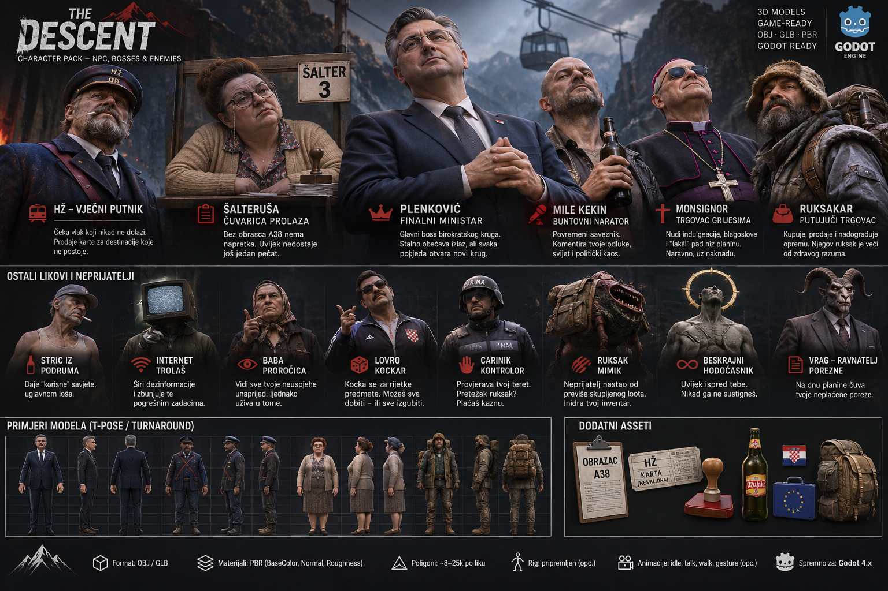

# DownhillRoguelite

**An endless downhill survival roguelite about carrying too much, losing your footing, and chasing an unreachable godhood.**

Built with **Godot 4 (C# / .NET)** · In active development

## Character pack — concept art

*Character roster and visual direction for future NPCs, enemies, bosses and props. This is concept artwork, not a claim that the depicted 3D models are already implemented or downloadable.*

## About the game

Descend an ever-changing mountain through nine circles inspired by Dante's *Inferno*. Manage your backpack, balance your cargo, survive the weather and encounters, and keep descending toward a divinity you can never quite reach.

## Development

- Third-person descent and survival gameplay
- Physical balance, cargo weight, backpack packing and equipment wear
- Procedural routes, environmental hazards, weather and wildlife
- Roguelite runs, progression and persistent narrative encounters
- A mysterious companion who comments on the journey

Features and content are under active development; availability varies by branch and build.

## Playtest

See [Releases](https://github.com/vstimac/DownhillRoguelite/releases) for available test builds.

## Build from source

1. Install a compatible **Godot .NET** editor and the **.NET SDK**.
2. Clone the repository.
3. Open `project.godot` in Godot .NET and let the C# project build.
4. Run the project or use `dotnet build` from the repository root.

Some development features may rely on optional, locally installed dependencies. See [CLAUDE.md](CLAUDE.md) and [addons/README.md](addons/README.md).

## Project documentation

Explore [docs/](docs/) for game design and systems, [narrative/](narrative/) for the companion and dialogue work, and [art/](art/) for visual assets.

---

**DownhillRoguelite** is an independent game project in development.
